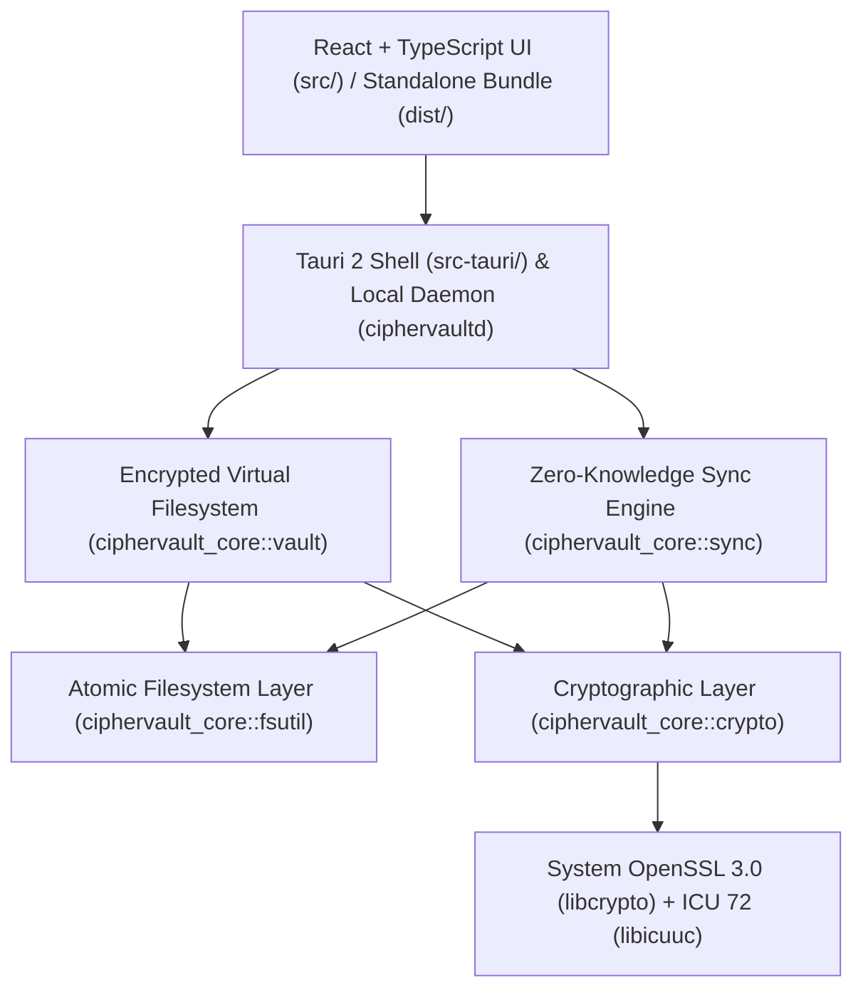

# Architecture (`ARCHITECTURE.md`)

## 1. Layered Separation of Concerns

CipherVault-X strictly separates user interface, IPC transport, virtual filesystem, atomic storage primitives, and cryptographic primitives into distinct layers with one-way dependencies:

1. **Cryptographic Layer ([`crates/ciphervault-core/src/crypto/`](file:///home/antigravity/voidechoes7/CiphervaultX/crates/ciphervault-core/src/crypto/mod.rs))**:
   - Performs **zero filesystem or network I/O**.
   - Delegates all primitive operations to audited system libraries (`libcrypto` OpenSSL 3.0 and `libicuuc` ICU) through [`crypto::ffi`](file:///home/antigravity/voidechoes7/CiphervaultX/crates/ciphervault-core/src/crypto/ffi.rs).
   - Enforces automatic memory scrubbing on drop via `OPENSSL_cleanse` ([`SecretBuf`](file:///home/antigravity/voidechoes7/CiphervaultX/crates/ciphervault-core/src/crypto/ffi.rs#L508-L542) and [`Masterkey`](file:///home/antigravity/voidechoes7/CiphervaultX/crates/ciphervault-core/src/crypto/keys.rs#L14-L66)).
2. **Atomic Filesystem Layer ([`crates/ciphervault-core/src/fsutil.rs`](file:///home/antigravity/voidechoes7/CiphervaultX/crates/ciphervault-core/src/fsutil.rs))**:
   - [`AtomicFile`](file:///home/antigravity/voidechoes7/CiphervaultX/crates/ciphervault-core/src/fsutil.rs#L17-L84) stages every write in `.cvx-tmp-<random>` inside the same directory, flushes and calls `sync_all()`, and atomically renames over the target path.
   - If any write or AEAD tag verification fails mid-stream, `Drop` deletes the temporary file so corrupted or unauthenticated partial plaintext/ciphertext is never exposed.
3. **Encrypted Virtual Filesystem ([`crates/ciphervault-core/src/vault/mod.rs`](file:///home/antigravity/voidechoes7/CiphervaultX/crates/ciphervault-core/src/vault/mod.rs))**:
   - Maps cleartext virtual paths (`/Financials/Q4/budget.csv`) onto the flattened Cryptomator Format 8 directory structure (`d/<2>/<30>/<base64url>.c9r`).
   - Handles long-filename deflation (`.c9s/name.c9s`, `contents.c9r`, `dir.c9r`) when the encrypted filename exceeds `shorteningThreshold` (220 chars).
   - Stores an encrypted `dirid.c9r` backup in each storage directory so `check_integrity()` can verify directory-ID bindings.
4. **Zero-Knowledge Synchronization Layer ([`crates/ciphervault-core/src/sync.rs`](file:///home/antigravity/voidechoes7/CiphervaultX/crates/ciphervault-core/src/sync.rs))**:
   - Operates purely on ciphertext files without needing an unlocked `Masterkey` in memory.
   - Runs [`verify_ciphertext_only`](file:///home/antigravity/voidechoes7/CiphervaultX/crates/ciphervault-core/src/sync.rs#L106-L172) before every upload to guarantee that no accidental plaintext file, temporary file, or unwrapped key is ever transmitted to a [`CloudAdapter`](file:///home/antigravity/voidechoes7/CiphervaultX/crates/ciphervault-core/src/sync.rs#L38-L45).
5. **Shell & UI Layer ([`src-tauri/`](file:///home/antigravity/voidechoes7/CiphervaultX/src-tauri/src/lib.rs), [`src/`](file:///home/antigravity/voidechoes7/CiphervaultX/src/App.tsx))**:
   - Raw keys never cross the IPC boundary into the WebView; the WebView only holds opaque vault UUIDs (`jti`).
   - Least-privilege Tauri capabilities ([`src-tauri/capabilities/default.json`](file:///home/antigravity/voidechoes7/CiphervaultX/src-tauri/capabilities/default.json)) restrict the frontend to `core:default`, `dialog:allow-open`, and `dialog:allow-save`.
